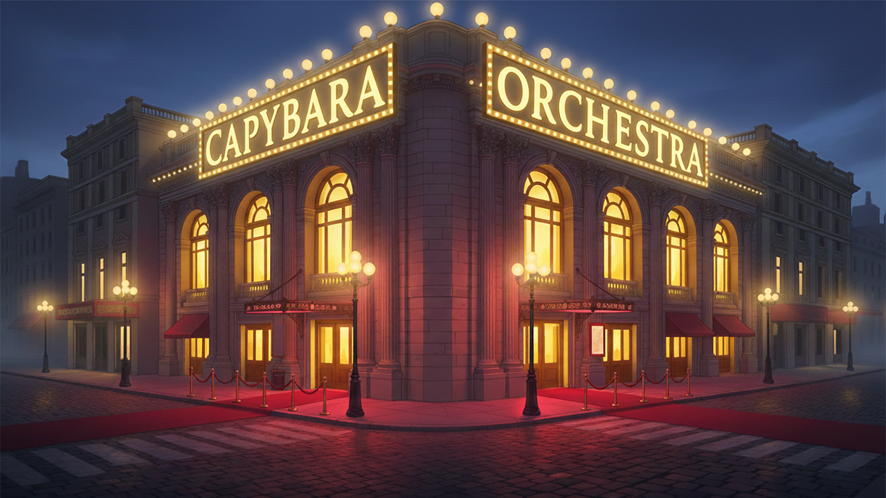

<div align="center">

# 🎵 Capybara Orchestra 🐹 🎻

**A cozy, musical idle-clicker game powered by Python & Pygame.**  
*Tap to play piano, collect notes, recruit adorable capybara musicians, and build a harmonious grand symphony!*

[](https://www.python.org/)
[](https://www.pygame.org/)
[](LICENSE)
[](CONTRIBUTING.md)

[English](README.md) • [Türkçe](README.tr.md)

<br/>



</div>

---

## 📖 Overview

**Capybara Orchestra** is an interactive incremental rhythm-clicker game written in Python using **Pygame**. 

You start as a lone, dedicated Capybara pianist playing gentle melodies on stage. Each tap produces musical notes (the in-game currency). As your notes accumulate, you can hire fellow capybara virtuosos—cymbals, electric organ, violin, drums, and choir. 

What makes Capybara Orchestra unique is its **dynamic multi-track sound design**: as you recruit new musicians, their unique instrument tracks join the live playback in real time, transforming a humble solo into a full-scale orchestral concert. Fill the hall with an appreciative audience for the grand crescendo!

---

## ✨ Features

- 🎹 **Dynamic Layered Audio Engine:** Multi-track synchronized playback where each recruited band member adds their own musical layer in real-time.
- 🐹 **Charming Capybara Band Members:** Distinct character sprites with idle and active performance animation frames.
- ⚡ **Incremental Idle/Clicker Progression:** Earn musical notes with each tap, boost click strength, and purchase upgrades with massive multipliers.
- 💬 **Dynamic Floating Score Feedback:** Visual "+N" floating notes on click for immediate, tactile gameplay feedback.
- 🎚️ **Interactive In-Game HUD & Settings:** Built-in pause overlay, master volume slider, and smooth scene navigation.
- 🌿 **Zero Bloat & Lightweight:** Pure Python and Pygame with no heavyweight game engine overhead.

---

## 🎼 The Orchestra & Upgrades

As you gather musical notes, open the **Upgrade Menu** to unlock each capybara musician:

| Musician | Instrument | Base Cost (Notes) | Multiplier | Role / Stage Position |
| :--- | :---: | :---: | :---: | :--- |
| **Pianist Capybara** *(You)* | 🎹 Grand Piano | *Starter* | **1x** | Lead soloist (Stage Center) |
| **Crash Capibara** | 💥 Crash Cymbals | 1,000 | **4x** | Rhythmic accent (Stage Front-Left) |
| **Orgcu Capibara** | 🎹 Electric Organ | 5,000 | **10x** | Melodic harmony (Stage Right Corner) |
| **Kemancı Capibara** | 🎻 Classical Violin | 20,000 | **25x** | Expressive strings (Stage Front-Right) |
| **Baterist Capibara** | 🥁 Drum Kit | 75,000 | **50x** | Driving rhythm section (Stage Left Corner) |
| **Koro Capibara** | 🎶 Capybara Choir | 300,000 | **100x** | Majestic choir vocals (Stage Center-Back) |
| **Seyirci (Audience)** | 👏 Full Hall Audience | 1,000,000 | **500x** | The Grand Symphony finale with a full cheering audience! |

---

## 🚀 Getting Started

### Prerequisites

- **Python 3.8+** installed on your system.
- `pip` (Python package manager).

### Installation

1. **Clone the repository:**
   ```bash
   git clone https://github.com/MEmin00/CapybaraOrchestra.git
   cd CapybaraOrchestra
   ```

2. **Create and activate a virtual environment (recommended):**
   ```bash
   # On macOS / Linux:
   python3 -m venv venv
   source venv/bin/activate

   # On Windows:
   python -m venv venv
   venv\Scripts\activate
   ```

3. **Install the dependencies:**
   ```bash
   pip install -r requirements.txt
   ```

4. **Launch the game:**
   ```bash
   python main.py
   ```

---

## 🕹️ Controls & Gameplay

- **Left Mouse Click:**
  - Click on the pianist capybara to generate notes.
  - Click any unlocked musician on stage to trigger their playing animation & sound!
  - Click buttons to navigate between menus.
- **Top-Right "Upgrade" Button:** Open the shop to hire new orchestra members.
- **ESC / Pause Button:** Open the pause menu to adjust music volume or exit to the main menu.

---

## 📁 Project Structure

```text
CapybaraOrchestra/
├── main.py                     # Game loop, state coordinator & global data
├── requirements.txt            # Python dependencies (pygame)
├── LICENSE                     # MIT License
├── README.md                   # English documentation
├── README.tr.md                # Türkçe dokümantasyon
│
├── oyun/                       # Game core logic & scenes
│   ├── anaMenu.py              # Main menu scene & start screen
│   ├── sahne.py                # Main stage, orchestra coordination & mixer
│   ├── upgrade.py              # Upgrade/shop UI with scrollable panel
│   ├── arayuz.py               # Reusable UI primitives (Buttons, etc.)
│   └── kayanMetin.py           # Floating score indicator (+Notes)
│
├── varliklar/                  # Assets directory
│   ├── capibaralar/            # Character sprites (idle & active states)
│   ├── kullaniciArayuzu/       # UI icons (pause button, checkmarks, etc.)
│   └── ses/                    # Multitrack audio files (.mp3)
│
└── images/                     # Promotional screenshots & backgrounds
```

---

## 🗺️ Roadmap & Future Enhancements

Contributions and ideas are warmly welcome! Here are some features on the wishlist:

- [ ] 💾 **Persistent Game Save/Load:** Save player note count and unlocked orchestra members to a local JSON file.
- [ ] ⏱️ **Idle Passive Income (NPS):** Automatic generation of notes per second without needing to click constantly.
- [ ] 🏆 **Achievements System:** Fun badges for hitting milestones (e.g., "First Symphony", "Capybara Fanatic").
- [ ] 🎷 **Additional Instruments:** Jazz Saxophone, Harp, Accordion, and Triangle capybaras.
- [ ] 🌐 **Web/Browser Port:** Export playable web build using Pygbag for Itch.io.
- [ ] ✨ **Particle Effects:** Musical note sparkles and confetti on big milestone purchases.

---

## 🤝 Contributing

We welcome contributions from everyone! Whether you want to fix a bug, add a new capybara musician, optimize sound performance, or improve the UI:

1. **Fork** the repository.
2. Create your feature branch (`git checkout -b feature/NewMusician`).
3. Commit your changes (`git commit -m 'Add Saxophone Capybara'`).
4. Push to the branch (`git push origin feature/NewMusician`).
5. Open a **Pull Request**.

---

## 📜 License

This project is open-source and licensed under the [MIT License](LICENSE). Feel free to learn from it, modify it, and expand the orchestra!

---

## 👥 Authors & Credits

Developed with ❤️ by:

- **[Mehmet Emin Dereci](https://github.com/MEmin00)** — Lead & Development
- **[Berat Salih Ersoy](https://github.com/beratersoy0)** — Development
- **[Tugay Arıcan](https://github.com/tugayarican)** — Music & Audio Design / Development

*Contributions, stars ⭐, and feedback are always appreciated!*
